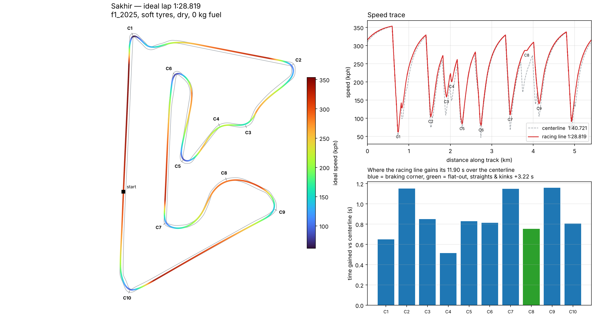
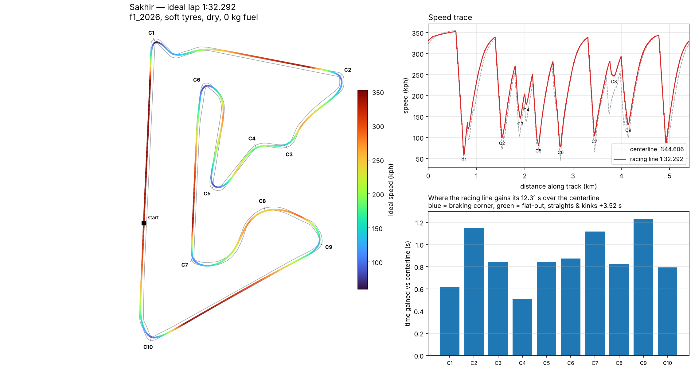

# DM ME ON DISCORD IF YOU NEED ANY HELP @1nvisss

# 🏁 Ideal Lap Time Calculator

Give it an F1 circuit and it works out the **fastest possible lap**: it finds the optimal racing line through every corner using the real track geometry, then drives a physics model of the car along that line at the limit of grip, power and braking.



- 🗺️ **Real circuits** — 25 surveyed centerlines with track widths (Sakhir, Silverstone, Spa, Monza, Suzuka, Interlagos, Red Bull Ring...)
- 📐 **Optimal racing line** — the line through each corner is *computed*, not guessed: outside on entry, clip the apex, use all the track on exit
- 🏎️ **Lap physics** — downforce, drag, tyre grip (with load sensitivity), traction, braking, DRS / 2026 active aero, energy-limited 2026 ERS
- 🔍 **Corner-by-corner breakdown** — braking point, entry / apex / exit speed, apex radius, peak g, and how much time the line gains in each corner
- ✅ **Calibrated** — the 2025 car lands within ±2.4% of real 2025 pole laps

## Quick start

```bash
pip install -r requirements.txt
python -m laptime bahrain
python -m laptime bahrain --car f1_2026 --compare 1:31.694 --plot bahrain.png
python -m laptime --list
```

```text
$ python -m laptime bahrain --compare 1:31.694

Sakhir  (5.404 km)  |  f1_2025  |  soft tyres, dry, 0 kg fuel
==============================================================================
  IDEAL LAP            1:28.819
    Sector 1           0:28.520
    Sector 2           0:33.416
    Sector 3           0:26.883
  Centerline lap       1:40.721   (the optimal line is worth 11.902 s)
  Top / min speed      353.8 / 61.9 kph
  Peak cornering       5.42 g    peak braking 6.13 g    accelerating 81% of the lap
  DRS                  open on 50% of the lap

  Corner by corner (detected corners, numbering is not the official turn numbering)
  ----------------------------------------------------------------------------
   #   Dir  Type       Brake    Entry  Apex   Exit   Apex     Peak  Line
                       for      kph    kph    kph    radius   g     gains
   C1    R  braking     140 m    354     62     82     13 m   3.4  +0.65 s
   C2    R  braking     114 m    329    104    171     32 m   2.7  +1.15 s
   C3    R  braking      82 m    273    159    184     62 m   3.4  +0.85 s
   C4    L  braking      24 m    223    200    242     81 m   4.0  +0.51 s
   C5    R  braking     110 m    262     84    116     23 m   2.7  +0.83 s
   C6    L  braking     140 m    283     80     91     22 m   3.5  +0.81 s
   C7    L  braking     112 m    330    109    253     34 m   2.8  +1.15 s
   C8    R  flat-out     flat    276    286    301    119 m   5.4  +0.75 s
   C9    R  braking     130 m    309    140    183     51 m   3.4  +1.16 s
   C10   R  braking     124 m    338     91    139     28 m   2.6  +0.81 s
   straights / kinks                                             +3.22 s

  Your lap 1:31.694 vs ideal: +2.875 s  (96.9% of ideal pace)
```

## How it works

**1. Track geometry.** Each circuit is a surveyed centerline with the distance to the left and right edge at every point. A periodic spline through it gives a smooth closed path, and curvature `k = 1/radius` comes from the spline's derivatives.

**2. The optimal line (corner by corner).** Every point on the line is the centerline point slid sideways: `p = c + a·n`. The offsets `a` are chosen to minimise the total squared curvature of the whole lap while staying inside the track:

```
minimise   Σ |p[i-1] - 2·p[i] + p[i+1]|²      subject to   -(w_right - margin) ≤ a ≤ (w_left - margin)
```

That's a box-constrained quadratic program, solved with a projected-Newton method in well under a second. It's reweighted by local point spacing and iterated, so hairpins genuinely open up instead of hugging the inside. Using less curvature means a bigger radius, which means more speed. That's why the "outside → apex → outside" line falls out of the maths on its own.

**3. Ideal speed at every metre.**
- *Corner limit*: the fastest speed where tyre grip can still supply the centripetal force, `m·v²·|k| = F_grip(N)`. Here `N = m·g + ½·ρ·ClA·v²` grows with downforce, and `F_grip = μ·N₀·(N/N₀)^(1-c)` captures the tyre's load sensitivity.
- *Forward pass*: accelerate as hard as power, rear-tyre traction and the friction ellipse allow.
- *Backward pass*: brake as late as possible and still make every corner.
- The ideal speed is the minimum of all three; integrating `ds/v` gives the lap. It's solved over three laps and the middle one kept, so it's a proper flying lap.

**4. 2026 energy management.** The 350 kW MGU-K can't run all lap on ~8.5 MJ, so the solver deploys it where the car is slowest (where energy buys the most time). It searches for the deployment threshold that spends exactly the per-lap budget, and also models the ERS taper between 290 and 355 kph.

## Accuracy

The `f1_2025` car's grip, downforce and load sensitivity were fitted to five 2025 pole laps:

| Circuit | 2025 pole | Model (`f1_2025`) | Error |
|---|---|---|---|
| Sakhir (Bahrain) | 1:29.841 (Piastri) | 1:28.819 | -1.1% |
| Silverstone (Britain) | 1:24.892 (Verstappen) | 1:25.716 | +1.0% |
| Spa (Belgium) | 1:40.562 (Norris) | 1:42.967 | +2.4% |
| Monza (Italy) | 1:18.792 (Verstappen) | 1:20.186 | +1.8% |
| Suzuka (Japan) | 1:26.983 (Verstappen) | 1:26.806 | -0.2% |

Spa and Monza come out slow because real teams run special low-downforce wings there, while the model uses one setup everywhere. Treat other circuits as estimates: they're uncalibrated, and the Yas Marina (5.55 km) and Albert Park (5.30 km) data are the pre-2021/2022 layouts.

## Cars, tyres and conditions

| Car | What it is |
|---|---|
| `f1_2025` | 2022–2025 ground-effect car with DRS, calibrated (above) |
| `f1_2026` | Derived from the 2025 car using published 2026 rule targets: 768 kg, ~30% less downforce, ~55% less drag in straight-line mode, ~400 kW ICE + 350 kW MGU-K limited to ~8.5 MJ/lap. **Not** calibrated against real 2026 laps. |

Tyres: `soft`, `medium`, `hard`, `intermediate`, `wet`. Conditions: `dry`, `damp`, `wet`. Options include `--fuel KG`, `--tyre-age LAPS`, `--margin M` (how close to the edge the car's centre gets), `--json`, and `--plot FILE.png`.

| 2025 car at Sakhir | 2026 car at Sakhir |
|---|---|
|  |  |

Fun detail: Turn 12 at Sakhir is flat-out at 5.4 g in the 2025 car, but the lower-downforce 2026 car has to brake for it.

## Python API

```python
import laptime

r = laptime.simulate("silverstone", car="f1_2025", tyre="soft", conditions="dry", fuel_kg=0)
print(r.racing.lap_time, r.line_gain)
for c in r.corners:
    print(c.number, c.kind, c.entry_kph, c.apex_kph, c.exit_kph, c.gain_s)
```

## Limitations

- **Point-mass, quasi-steady-state model.** No yaw dynamics, suspension, elevation or banking. The driver is perfect.
- **Minimum curvature isn't quite minimum time.** On long flat-out sections the shortest path matters more than the widest arc, so on an oval (`IMS`) the line gains nothing.
- **Geometry noise.** Small wiggles in the surveyed geometry can shift lap times by a few tenths.
- **Detected corners only.** Corners are numbered C1, C2… as the model finds them, not by official turn numbers.

## Roadmap ideas

- Minimum-*time* line (optimise the line and speed together)
- Import SimHub / F1 25 UDP telemetry and overlay your real lap on the ideal one
- Per-track downforce levels (low-drag Monza and Spa)
- Elevation and banking

## Tests

```bash
python -m pytest -q
```

These cover the geometry (official track lengths, curvature of a circle), the line (stays inside track limits, opens up hairpins), the physics (closed-form corner speed, power = drag at top speed, skidpad equilibrium, the ERS energy budget), the 2025 pole calibration, corner sanity checks and the CLI.

## Credits

Circuit data: [TUMFTM racetrack-database](https://github.com/TUMFTM/racetrack-database) by the Institute of Automotive Technology, TU Munich, licensed under LGPL-3.0 (see `laptime/data/tracks/LICENSE`). The minimum-curvature approach follows the same idea as TUMFTM's global race trajectory optimisation.

Built by Invis55 💻 — made for F1 fans, engineers-in-the-making, and anyone who likes shaving milliseconds 🧠
